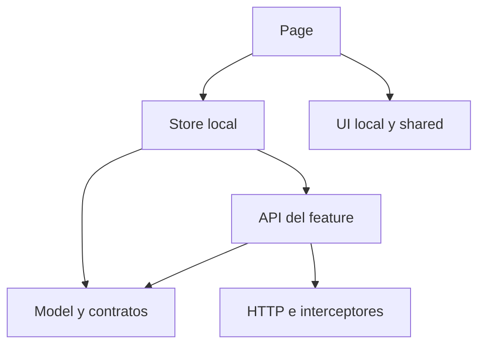

# Arquitectura y estructura del frontend del restaurante

**Versión:** 1.0  
**Fecha:** 13 de octubre de 2026  
**Organización:** SoftPrimeSolutions — `com.softprimesolutions`  
**Base:** B06 v1.0 y ESTRUCTURA_BACKEND_RESTAURANTE.md v1.3.1.  
**Ubicación sugerida:** `docs/arquitectura/ESTRUCTURA_FRONTEND_RESTAURANTE.md`.

## 1. Decisión de arquitectura

Se define una aplicación web **Angular 22, standalone y organizada por funcionalidades**, con carga diferida de rutas, TypeScript estricto, Angular Material/CDK y SCSS. Mantiene la selección propuesta en B06 para los formularios y pantallas de operación del restaurante. Es un frontend modular con un único artefacto web y un backend HTTP; la separación de carpetas permite desarrollar por área sin convertir cada área en una aplicación independiente.

Este documento desarrolla la planificación: especifica rutas, archivos, responsabilidades y contratos. Los árboles y fragmentos no constituyen todavía una aplicación creada, compilada o probada. El prototipo existente sirve como referencia funcional; no se presupone que ya use esta estructura.

La organización principal responde a las tareas del usuario. Dentro de cada funcionalidad se separan páginas, componentes locales, estado, formularios y acceso a datos. La guía oficial recomienda agrupar por áreas funcionales; los nombres concretos de las subcarpetas de este documento son una convención propia del proyecto. [F01]

### 1.1. Herramientas y alcance inicial

| Área | Selección | Criterio para este proyecto |
|---|---|---|
| Framework | Angular 22.x + Angular CLI | Continuidad con B06; navegación, formularios e integración HTTP dentro del mismo framework. |
| Lenguaje | TypeScript con `strict` y `strictTemplates` | Contratos y plantillas comprobados durante compilación. |
| Componentes | Standalone | Imports explícitos y rutas por funcionalidad. |
| UI | Angular Material + CDK | Controles consistentes, tablas, diálogos y soporte para interacción accesible. |
| Estilos | SCSS + tokens de diseño | Tema común y estilos locales por componente. |
| Estado | Signals y `computed` | Estado de presentación y valores derivados por funcionalidad. |
| Asincronía | RxJS + HttpClient | Consultas, cancelación y coordinación de acciones. |
| Formularios | Reactive Forms tipados | Formularios operativos, validaciones y errores por campo. |
| Navegación | Angular Router | Rutas diferidas, parámetros y protección de navegación. |
| Pruebas | Runner Vitest del CLI + Playwright para E2E | Comportamiento de componentes y recorridos completos. |
| Calidad | Angular ESLint + Prettier | Convenciones, imports y formato verificables. |
| Entorno | Node 24 compatible + npm | Mantener un único lockfile y reproducibilidad con `npm ci`. |

Angular 22 figura con soporte activo en la documentación consultada, sin etiquetarlo como LTS en esta fecha. Fijar los parches exactos del framework y CLI, Material/CDK, Node, TypeScript y RxJS al crear el repositorio. La tabla oficial consultada para Angular 22.0.x admite Node `^24.15.0`, TypeScript `>=6.0.0 <6.1.0` y RxJS `^7.4.0`, entre otras opciones; verificar la fila aplicable a la versión menor finalmente instalada. [F02, F03]

Se conserva npm como en B06. NgRx se evaluará si aparece estado compartido complejo que los stores locales no resuelvan. SSR, microfrontends y operaciones de venta offline requieren una necesidad y una decisión propias; no forman parte de la base inicial. La SPA cubre administración, atención, cocina y caja; una web pública comercial tendría requisitos distintos.

### 1.2. Relación con los patrones del backend

| Concepto | Aplicación en frontend |
|---|---|
| Modularidad | Áreas funcionales con rutas, estado y acceso a API propios. |
| DDD | Usar el lenguaje del negocio y respetar sus límites; el navegador trabaja con representaciones y borradores. |
| Clean Architecture | Separar presentación, coordinación y acceso HTTP; mantener contratos y funciones puras donde aporten independencia. |
| Puertos y adaptadores | El servicio API de la funcionalidad adapta HTTP a tipos propios. Incorporar un puerto explícito solo cuando exista una sustitución real que lo justifique. |
| CQRS | Distinguir consultas y acciones de modificación en métodos y flujos. No crear un bus ni una clase por operación trivial. |
| Result | Normalizar resultados esperados con `ApiResult<T>`; no asumir que el servidor serializa su `Result<T>` Java. |

Los importes definitivos, stock, transiciones válidas, autorizaciones y atomicidad permanecen bajo responsabilidad del backend. La interfaz puede validar campos y mostrar cálculos provisionales; debe reflejar la respuesta confirmada del servidor.

## 2. Organización del repositorio

```text
restaurante/
  backend/
  frontend/
    package.json
    package-lock.json
    angular.json
    tsconfig.json
    tsconfig.app.json
    tsconfig.spec.json
    eslint.config.js
    .prettierrc.json
    .nvmrc
    .npmrc
    README.md
    playwright.config.ts
    public/
      favicon.ico
      assets/
        brand/
        icons/
      config/
        app-config.json
    src/
      index.html
      main.ts
      styles.scss
      proxy.conf.json
      environments/
        environment.ts
        environment.development.ts
      styles/
        _tokens.scss
        _theme.scss
        _typography.scss
        _layout.scss
        _utilities.scss
      app/
        app.ts
        app.html
        app.scss
        app.config.ts
        app.routes.ts
        core/
        shell/
        shared/
        features/
          identidad/
          catalogos/
          atencion/
          produccion/
          caja/
          abastecimiento/
          comprobantes/
          consulta/
    e2e/
      fixtures/
        usuarios.fixture.ts
        restaurante.fixture.ts
      pages/
        login.page.ts
        pedidos.page.ts
        caja.page.ts
      auth-session.spec.ts
      abrir-pedido.spec.ts
      registrar-cobro.spec.ts
      paginacion-completa.spec.ts
      permisos-sucursal.spec.ts
      navegacion-teclado.spec.ts
  contracts/
    openapi.yaml
  docs/
    arquitectura/
      ESTRUCTURA_BACKEND_RESTAURANTE.md
      ESTRUCTURA_FRONTEND_RESTAURANTE.md
```

Los árboles siguientes son relativos a `frontend/src/app`. No se generan carpetas vacías ni todos los archivos de golpe: se crean al implementar cada flujo. Las pruebas unitarias `.spec.ts` se colocan junto al archivo probado; `e2e` contiene únicamente pruebas de navegador y sus apoyos.

### 2.1. Nombres e identidad del proyecto

| Elemento | Convención |
|---|---|
| Nombre del proyecto Angular | `restaurante-web` |
| Nombre npm propuesto | `@softprimesolutions/restaurante-web`, con `private: true` |
| Prefijo de selectores | `sps`, por ejemplo `sps-productos-listado-page` |
| Archivos | `kebab-case`, como `productos-listado-page.ts` |
| Clases y tipos | `PascalCase`, como `ProductosListadoPage` y `ProductoDetalle` |
| Variables y funciones | `camelCase`, como `cargarProductos` |
| Alias de imports | `@core/*`, `@shell/*`, `@shared/*`, `@features/*` |
| Backend relacionado | `com.softprimesolutions.restaurante` |

El frontend usa imports de TypeScript y rutas de carpetas; no necesita reproducir el paquete Java `com/softprimesolutions/restaurante`. El scope npm es una convención privada propuesta y no supone que exista o se publique un paquete en un registro.

Los alias se configuran en TypeScript y se mantienen compatibles con las herramientas elegidas. No sustituyen las reglas de dependencia. Los nombres cortos de los componentes siguen la guía actual del framework; se conserva el mismo nombre base para `.ts`, `.html`, `.scss` y `.spec.ts`. [F01]

## 3. Core: mecanismos transversales

```text
core/
  config/
    app-settings.ts
    app-config-loader.ts
    api-url.ts
  auth/
    session-store.ts
    session-api.ts
    session-contracts.ts
    session-lifecycle.ts
    auth-guard.ts
    permissions-guard.ts
    permissions-service.ts
  context/
    sucursal-context.ts
    sucursal-context.spec.ts
  http/
    auth-interceptor.ts
    session-expired-interceptor.ts
    correlation-interceptor.ts
    problem-details-mapper.ts
    problem-details-mapper.spec.ts
    http-request-options.ts
  error/
    global-error-handler.ts
    error-reporter.ts
    error-redaction.ts
  notifications/
    notification-service.ts
  api/
    generated/
      README.md
  observability/
    frontend-telemetry.ts
```

| Carpeta | Responsabilidad |
|---|---|
| `config` | Cargar configuración pública, resolver URL de API y comprobar campos requeridos. |
| `auth` | Sesión, estado de autenticación y decisiones de navegación. |
| `context` | Sucursal seleccionada y contexto operativo de la sesión. |
| `http` | Aspectos técnicos de peticiones y traducción de errores HTTP conocidos. |
| `error` | Errores inesperados y reporte técnico con datos redactados. |
| `notifications` | Mensajes transversales, sin decidir reglas de una funcionalidad. |
| `api/generated` | Cliente o tipos generados cuando el contrato OpenAPI esté estabilizado. |
| `observability` | Telemetría técnica del navegador, si está habilitada. |

Core no importa páginas ni stores de features. La sesión de core corresponde al usuario conectado; la administración de usuarios y roles vive en `features/identidad`. El código generado no se edita manualmente y no se consume directamente desde las plantillas; se envuelve en `data-access` de cada funcionalidad.

El flujo de autenticación definitivo sigue condicionado por DEC-06. Los nombres `session-api` y `session-lifecycle` definen responsabilidades, no endpoints de login o renovación ya existentes.

## 4. Shell: estructura visual y navegación

```text
shell/
  layouts/
    authenticated-layout/
      authenticated-layout.ts
      authenticated-layout.html
      authenticated-layout.scss
    public-layout/
      public-layout.ts
      public-layout.html
      public-layout.scss
    operation-layout/
      operation-layout.ts
      operation-layout.html
      operation-layout.scss
  navigation/
    navigation-item.ts
    navigation-config.ts
    sidebar/
      sidebar.ts
      sidebar.html
      sidebar.scss
    topbar/
      topbar.ts
      topbar.html
      topbar.scss
    sucursal-switcher/
      sucursal-switcher.ts
      sucursal-switcher.html
  pages/
    login/
      login-page.ts
      login-page.html
      login-page.scss
    forbidden/
      forbidden-page.ts
      forbidden-page.html
    not-found/
      not-found-page.ts
      not-found-page.html
    unavailable/
      unavailable-page.ts
      unavailable-page.html
```

`authenticated-layout` aporta navegación administrativa. `operation-layout` ofrece mayor espacio para atención, cocina y caja; reutiliza controles y no duplica sesión ni APIs. `public-layout` cubre el acceso o callback que corresponda al proveedor seleccionado. Shell conoce rutas y permisos de navegación, pero no importa implementaciones internas de los módulos.

La configuración del menú contiene etiquetas, iconos, enlaces y permisos. No contiene reglas financieras. Cambiar de sucursal cancela lecturas pendientes, vacía caches del contexto anterior y pide resolver borradores antes de continuar.

## 5. Shared: contratos y presentación reutilizable

```text
shared/
  contracts/
    result/
      api-result.ts
      api-error.ts
    http/
      problem-details.ts
    pagination/
      page-query.ts
      page-response.ts
      sort-criterion.ts
      cursor-query.ts
      cursor-page-response.ts
  ui/
    page-header/
      page-header.ts
      page-header.html
      page-header.scss
    page-state/
      page-state.ts
      page-state.html
      page-state.scss
    pagination/
      numbered-paginator.ts
      numbered-paginator.html
      cursor-navigation.ts
      cursor-navigation.html
    form-field-error/
      form-field-error.ts
      form-field-error.html
    confirm-dialog/
      confirm-dialog.ts
      confirm-dialog.html
    status-badge/
      status-badge.ts
      status-badge.html
    remote-selector/
      remote-selector.ts
      remote-selector.html
    amount-display/
      amount-display.ts
  format/
    money-format.ts
    quantity-format.ts
    date-format.ts
  validation/
    decimal-text-validator.ts
    required-trimmed-validator.ts
  testing/
    page-response-builder.ts
    api-error-builder.ts
```

Shared no importa core ni features y sus controles no ejecutan HTTP. Recibe datos y emite eventos. Por ejemplo, `remote-selector` notifica búsqueda y continuación; la funcionalidad carga productos o clientes. Un `status-badge` recibe etiqueta y tono; no contiene todos los estados del restaurante.

`money-format` presenta importes usando el contrato decimal acordado; no redefine el cálculo fiscal. Los formateadores y validadores puros se prueban donde haya riesgo real. `shared/testing` solo se importa desde pruebas.

No crear una tabla universal con decenas de banderas para reemplazar todas las páginas. Reutilizar paginador, estados, cabecera y controles; mantener las columnas y acciones propias cerca de cada listado.

## 6. Plantilla interna de una funcionalidad

```text
features/<area>/<funcionalidad>/
  <funcionalidad>.routes.ts
  pages/
    listado/
      <funcionalidad>-listado-page.ts
      <funcionalidad>-listado-page.html
      <funcionalidad>-listado-page.scss
      <funcionalidad>-listado-page.spec.ts
    crear/
      <recurso>-crear-page.ts
      <recurso>-crear-page.html
    editar/
      <recurso>-editar-page.ts
      <recurso>-editar-page.html
    detalle/
      <recurso>-detalle-page.ts
      <recurso>-detalle-page.html
  ui/
    <recurso>-form/
      <recurso>-form.ts
      <recurso>-form.html
      <recurso>-form.scss
    <recurso>-filters/
      <recurso>-filters.ts
      <recurso>-filters.html
  data-access/
    <funcionalidad>-api.ts
    dto/
      <recurso>-request.ts
      <recurso>-response.ts
    mapper/
      <recurso>-api-mapper.ts
  state/
    <funcionalidad>-list-store.ts
    <recurso>-editor-store.ts
  model/
    <recurso>-resumen.ts
    <recurso>-detalle.ts
    <recurso>-draft.ts
    <recurso>-filters.ts
    <recurso>-view-state.ts
  forms/
    <recurso>-form-factory.ts
    <recurso>-form-mapper.ts
    <recurso>-validators.ts
```

Es una plantilla de responsabilidades, no un generador CRUD obligatorio. Una pantalla de auditoría no incorpora edición; un cambio de estado puede usar un diálogo local en vez de una página nueva. Los `.spec.ts` se añaden junto a los archivos cuyo comportamiento se necesita comprobar; no hay que repetir pruebas triviales por cada mapper.

| Subcarpeta | Contenido | Regla |
|---|---|---|
| `pages` | Componentes de ruta y coordinación de la pantalla. | Consumen el store; no ensamblan URL ni manejan SQL. |
| `ui` | Componentes específicos de esa funcionalidad. | Inputs/outputs claros; sin navegación o HTTP ocultos. |
| `data-access` | Llamadas API, DTO del transporte y traducciones. | Único punto de acceso HTTP del feature. |
| `state` | Signals, carga, filtros, edición y acciones. | Ámbito local; usa la API y conserva los estados necesarios para la vista. |
| `model` | Tipos de pantalla, filtros y borradores. | TypeScript puro; no representa entidades de persistencia Java. |
| `forms` | Construcción del formulario y conversión entre formulario y borrador. | Puede usar Angular Forms; no calcula autorizaciones definitivas. |

Un store ya cumple la función de fachada de la pantalla. No añadir simultáneamente un facade y un store que solo reenvíen los mismos métodos. En una consulta trivial la página puede usar un servicio pequeño; se crea store cuando hay estado que coordinar.

## 7. Áreas funcionales y sus subestructuras

### 7.1. Identidad

```text
features/identidad/
  identidad.routes.ts
  usuarios/
    usuarios.routes.ts
    pages/
      listado/usuarios-listado-page.ts
      crear/usuario-crear-page.ts
      editar/usuario-editar-page.ts
      detalle/usuario-detalle-page.ts
    ui/
      usuario-form/usuario-form.ts
      asignacion-roles/asignacion-roles.ts
      asignacion-sucursales/asignacion-sucursales.ts
    data-access/
      usuarios-api.ts
      dto/usuario-request.ts
      dto/usuario-response.ts
      mapper/usuario-api-mapper.ts
    state/usuarios-list-store.ts
    state/usuario-editor-store.ts
    model/usuario-detalle.ts
    model/usuario-filters.ts
    forms/usuario-form-factory.ts
  roles/
    roles.routes.ts
    pages/listado/roles-listado-page.ts
    pages/editar/rol-editar-page.ts
    ui/rol-permisos/rol-permisos.ts
    data-access/roles-api.ts
    state/rol-editor-store.ts
    model/rol-detalle.ts
    forms/rol-form-factory.ts
  empleados/
    empleados.routes.ts
    pages/listado/empleados-listado-page.ts
    pages/editar/empleado-editar-page.ts
    data-access/empleados-api.ts
    state/empleado-editor-store.ts
    model/empleado-detalle.ts
    forms/empleado-form-factory.ts
```

Los permisos se presentan como catálogo/asignación según el backend. No crear mantenimiento libre de códigos de seguridad si el contrato no lo contempla. Las relaciones usuario–rol y rol–permiso se gestionan dentro de estas pantallas.

### 7.2. Catálogos: ejemplo desarrollado

```text
features/catalogos/
  catalogos.routes.ts
  productos/
    productos.routes.ts
    pages/
      listado/
        productos-listado-page.ts
        productos-listado-page.html
        productos-listado-page.scss
        productos-listado-page.spec.ts
      crear/
        producto-crear-page.ts
        producto-crear-page.html
      editar/
        producto-editar-page.ts
        producto-editar-page.html
      detalle/
        producto-detalle-page.ts
        producto-detalle-page.html
    ui/
      producto-form/
        producto-form.ts
        producto-form.html
        producto-form.scss
      producto-filters/
        producto-filters.ts
        producto-filters.html
      precio-sucursal-form/
        precio-sucursal-form.ts
        precio-sucursal-form.html
    data-access/
      productos-api.ts
      productos-api.spec.ts
      dto/
        crear-producto-request.ts
        editar-producto-request.ts
        producto-response.ts
      mapper/
        producto-api-mapper.ts
    state/
      productos-list-store.ts
      productos-list-store.spec.ts
      producto-editor-store.ts
    model/
      producto-resumen.ts
      producto-detalle.ts
      producto-draft.ts
      producto-filters.ts
    forms/
      producto-form-factory.ts
      producto-form-mapper.ts
      producto-validators.ts
  clientes/
    clientes.routes.ts
    pages/listado/clientes-listado-page.ts
    pages/editar/cliente-editar-page.ts
    data-access/clientes-api.ts
    state/clientes-list-store.ts
    model/cliente-detalle.ts
    forms/cliente-form-factory.ts
  maestros/
    maestros.routes.ts
    categorias/categorias-page.ts
    unidades/unidades-page.ts
    impuestos/impuestos-page.ts
    data-access/maestros-api.ts
  negocio/
    negocio.routes.ts
    configuracion/negocio-configuracion-page.ts
    sucursales/sucursales-page.ts
    data-access/negocio-api.ts
```

Las pantallas de maestros pueden mantenerse pequeñas y crecer con la plantilla cuando exista esa necesidad. Las recetas están en producción, aunque el menú pueda ofrecer un enlace desde productos.

### 7.3. Atención

```text
features/atencion/
  atencion.routes.ts
  mesas/
    mesas.routes.ts
    pages/salon/salon-page.ts
    ui/mesa-card/mesa-card.ts
    data-access/mesas-api.ts
    state/salon-store.ts
    model/mesa-resumen.ts
  reservas/
    reservas.routes.ts
    pages/listado/reservas-listado-page.ts
    pages/crear/reserva-crear-page.ts
    data-access/reservas-api.ts
    state/reserva-editor-store.ts
    model/reserva-draft.ts
    forms/reserva-form-factory.ts
  pedidos/
    pedidos.routes.ts
    pages/listado/pedidos-listado-page.ts
    pages/crear/pedido-crear-page.ts
    pages/editar/pedido-editar-page.ts
    pages/detalle/pedido-detalle-page.ts
    ui/pedido-lines/pedido-lines.ts
    ui/producto-search/producto-search.ts
    ui/delivery-form/delivery-form.ts
    ui/pedido-summary/pedido-summary.ts
    data-access/pedidos-api.ts
    data-access/productos-lookup-api.ts
    data-access/dto/abrir-pedido-request.ts
    data-access/dto/pedido-response.ts
    data-access/mapper/pedido-api-mapper.ts
    state/pedidos-list-store.ts
    state/pedido-editor-store.ts
    model/pedido-draft.ts
    model/pedido-detalle.ts
    model/linea-pedido-draft.ts
    forms/pedido-form-factory.ts
    forms/pedido-form-mapper.ts
```

`pedidos-api` llama al endpoint coordinado del backend para abrir pedido, cuenta y detalles. El frontend no encadena tres escrituras independientes para simular esa transacción. `productos-lookup-api` adapta la consulta de selección requerida por esta pantalla; no importa el store ni la página de productos de catálogos.

### 7.4. Producción

```text
features/produccion/
  produccion.routes.ts
  comandas/
    comandas.routes.ts
    pages/tablero/comandas-tablero-page.ts
    ui/comanda-card/comanda-card.ts
    ui/estacion-filter/estacion-filter.ts
    data-access/comandas-api.ts
    state/comandas-board-store.ts
    model/comanda-resumen.ts
    model/detalle-comanda-view.ts
  recetas/
    recetas.routes.ts
    pages/listado/recetas-listado-page.ts
    pages/editar/receta-editar-page.ts
    ui/ingredientes-form/ingredientes-form.ts
    data-access/recetas-api.ts
    state/receta-editor-store.ts
    model/receta-draft.ts
    forms/receta-form-factory.ts
  estaciones/
    estaciones.routes.ts
    pages/listado/estaciones-listado-page.ts
    data-access/estaciones-api.ts
    model/estacion-resumen.ts
```

El estado operativo de preparación corresponde a los detalles de comanda conforme a V4. El tablero debe permitir acceder a todas las pendientes. La actualización inicial puede usar polling controlado, detenido al abandonar la ruta; SSE o WebSocket se incorporan cuando exista un contrato del backend. Un fallo de refresco mantiene visible el último dato con indicación de desactualización.

### 7.5. Caja

```text
features/caja/
  caja.routes.ts
  sesiones/
    sesiones.routes.ts
    pages/listado/sesiones-listado-page.ts
    pages/abrir/caja-abrir-page.ts
    pages/cerrar/caja-cerrar-page.ts
    data-access/sesiones-caja-api.ts
    state/sesion-caja-store.ts
    model/sesion-caja-detalle.ts
    forms/apertura-caja-form-factory.ts
    forms/cierre-caja-form-factory.ts
  cobros/
    cobros.routes.ts
    pages/cobrar/cuenta-cobrar-page.ts
    ui/pago-form/pago-form.ts
    ui/cuenta-summary/cuenta-summary.ts
    data-access/cobros-api.ts
    data-access/dto/registrar-cobro-request.ts
    state/cobro-store.ts
    model/cobro-draft.ts
    forms/pago-form-factory.ts
  movimientos/
    movimientos.routes.ts
    pages/listado/movimientos-caja-page.ts
    data-access/movimientos-caja-api.ts
    state/movimientos-caja-store.ts
  devoluciones/
    devoluciones.routes.ts
    pages/registrar/devolucion-registrar-page.ts
    data-access/devoluciones-api.ts
    state/devolucion-store.ts
    model/devolucion-draft.ts
    forms/devolucion-form-factory.ts
```

Un timeout de cobro puede dejar el resultado indeterminado: el store conserva la identidad de la operación y consulta/reconcilia antes de permitir repetirla. La protección de doble clic es complementaria a la idempotencia del servidor. Los saldos confirmados llegan de API.

### 7.6. Abastecimiento

```text
features/abastecimiento/
  abastecimiento.routes.ts
  inventario/
    inventario.routes.ts
    pages/stock/stock-page.ts
    pages/articulo/articulo-detalle-page.ts
    pages/movimiento/movimiento-registrar-page.ts
    ui/lotes-selector/lotes-selector.ts
    data-access/inventario-api.ts
    state/stock-list-store.ts
    state/movimiento-editor-store.ts
    model/stock-resumen.ts
    model/movimiento-draft.ts
    forms/movimiento-form-factory.ts
  compras/
    compras.routes.ts
    pages/listado/compras-listado-page.ts
    pages/crear/compra-crear-page.ts
    pages/recibir/compra-recibir-page.ts
    data-access/compras-api.ts
    state/compra-editor-store.ts
    model/compra-draft.ts
    forms/compra-form-factory.ts
  proveedores/
    proveedores.routes.ts
    pages/listado/proveedores-listado-page.ts
    pages/editar/proveedor-editar-page.ts
    data-access/proveedores-api.ts
    forms/proveedor-form-factory.ts
  almacenes/
    almacenes.routes.ts
    pages/listado/almacenes-listado-page.ts
    data-access/almacenes-api.ts
```

Los selectores de artículos y lotes son remotos. La lista visible no determina el stock total. La confirmación del movimiento debe reflejar el saldo devuelto por el backend y actualizar las consultas afectadas.

### 7.7. Comprobantes

```text
features/comprobantes/
  comprobantes.routes.ts
  documentos/
    documentos.routes.ts
    pages/listado/comprobantes-listado-page.ts
    pages/detalle/comprobante-detalle-page.ts
    data-access/comprobantes-api.ts
    state/comprobantes-list-store.ts
    model/comprobante-detalle.ts
  series/
    series.routes.ts
    pages/listado/series-listado-page.ts
    pages/editar/serie-editar-page.ts
    data-access/series-api.ts
    forms/serie-form-factory.ts
  envios/
    envios.routes.ts
    pages/listado/envios-listado-page.ts
    pages/detalle/envio-detalle-page.ts
    data-access/envios-api.ts
    state/envios-list-store.ts
    model/envio-detalle.ts
```

Documento y envío tienen estados diferentes. Mostrar estado, último intento y acciones autorizadas que entregue el contrato. El frontend no llama directamente al proveedor fiscal ni contiene sus credenciales.

### 7.8. Consultas y reportes

```text
features/consulta/
  consulta.routes.ts
  dashboard/
    pages/dashboard-page.ts
    data-access/dashboard-api.ts
    state/dashboard-store.ts
    model/dashboard-resumen.ts
  ventas/
    ventas.routes.ts
    pages/reporte/ventas-reporte-page.ts
    ui/ventas-filters/ventas-filters.ts
    data-access/ventas-report-api.ts
    state/ventas-report-store.ts
    model/ventas-filters.ts
    model/ventas-resumen.ts
  kardex/
    kardex.routes.ts
    pages/reporte/kardex-reporte-page.ts
    data-access/kardex-api.ts
    state/kardex-store.ts
    model/kardex-linea.ts
  auditoria/
    auditoria.routes.ts
    pages/listado/auditoria-listado-page.ts
    pages/detalle/auditoria-detalle-page.ts
    data-access/auditoria-api.ts
    state/auditoria-store.ts
    model/auditoria-evento.ts
  exportaciones/
    exportaciones.routes.ts
    pages/estado/exportacion-estado-page.ts
    data-access/exportaciones-api.ts
    state/exportacion-store.ts
    model/exportacion-estado.ts
```

Exportaciones es una capacidad condicionada a su contrato backend; no se presupone que ya exista un sistema de trabajos. Dashboard muestra indicadores calculados por API. Auditoría no incorpora formularios para modificar eventos.

En los árboles abreviados de esta sección, cada componente de pantalla o UI se acompaña de su `.html` y, cuando lo necesita, `.scss`. Los DTO, mappers y pruebas siguen la plantilla de la sección 6; no se omite su responsabilidad por abreviar un ejemplo.

## 8. Reglas de dependencia

| Área | Puede usar | Restricción |
|---|---|---|
| `app.config` y `app.routes` | Core, shell y entradas de rutas de features. | Son los puntos de composición. |
| `core` | Contratos shared y bibliotecas técnicas. | No importa implementaciones de features. |
| `shell` | Core, shared y metadatos de navegación. | No accede al estado interno de un feature. |
| `shared` | Otros elementos shared y Angular en su UI. | No importa core, shell o features. |
| `pages` | Store, formularios, UI local, core y shared. | No llama a HttpClient directamente. |
| `state` | API local, model, contratos shared y contexto de core. | No importa páginas ni manipula DOM. |
| `data-access` | HttpClient/cliente generado, DTO, mapper, model y contratos. | No muestra diálogos ni navega. |
| `model` | Tipos puros y contratos básicos cuando corresponda. | No importa Angular ni HttpClient. |
| `forms` | Angular Forms, model y validadores. | No realiza llamadas HTTP ocultas. |

Por defecto no hay imports directos entre áreas de features. Una pantalla que necesita datos de selección de otra área usa la API pública del backend mediante su adaptador local. Cuando un selector de negocio sea realmente compartido por varias pantallas, se diseña un contrato público de reutilización y se registra la excepción; no se mueve todo el negocio a shared ni se importan stores ajenos.

Configurar reglas de imports en ESLint para estos límites y revisar dependencias cíclicas en CI. El mero uso de alias no garantiza encapsulación. Evitar barrels globales que reexporten todas las páginas y terminen incorporando features al bundle inicial.



El diagrama representa dependencias principales. La página controla presentación; el store coordina; el adaptador interpreta HTTP. La configuración de la aplicación conecta las rutas y mecanismos transversales.

## 9. Rutas y alcance del estado

Cada área tiene un archivo `*.routes.ts`, y cada funcionalidad declara sus páginas. Las rutas de áreas se cargan con `loadChildren`; las páginas pueden usar `loadComponent`. [F04]

Ejemplo ilustrativo de una entrada en las rutas autenticadas:

```typescript
{
  path: 'catalogos',
  loadChildren: () => import('./features/catalogos/catalogos.routes')
    .then(m => m.CATALOGOS_ROUTES)
}
```

Ejemplo de rutas de productos; los componentes exportan las clases indicadas:

```typescript
export const PRODUCTOS_ROUTES: Routes = [
  {
    path: '',
    loadComponent: () => import('./pages/listado/productos-listado-page')
      .then(m => m.ProductosListadoPage)
  },
  {
    path: 'nuevo',
    loadComponent: () => import('./pages/crear/producto-crear-page')
      .then(m => m.ProductoCrearPage)
  },
  {
    path: ':id/editar',
    loadComponent: () => import('./pages/editar/producto-editar-page')
      .then(m => m.ProductoEditarPage)
  },
  {
    path: ':id',
    loadComponent: () => import('./pages/detalle/producto-detalle-page')
      .then(m => m.ProductoDetallePage)
  }
];
```

El archivo importa `Routes` desde `@angular/router`. Se completa con los guards correspondientes según el contrato de permisos; los códigos de permiso no se inventan en este ejemplo. Las rutas literales como `nuevo` preceden a las parametrizadas. El wildcard se coloca al final de las rutas de la aplicación.

| Pantalla | Ruta ilustrativa |
|---|---|
| Productos | `/catalogos/productos` |
| Crear producto | `/catalogos/productos/nuevo` |
| Editar producto | `/catalogos/productos/:id/editar` |
| Salón | `/atencion/mesas` |
| Pedidos | `/atencion/pedidos` |
| Cocina | `/produccion/comandas` |
| Cobrar cuenta | `/caja/cobros/:cuentaId` |
| Stock | `/abastecimiento/inventario` |
| Documentos | `/comprobantes/documentos` |
| Ventas | `/consulta/ventas` |

Los stores de listado/editor se proveen en la página por defecto y se destruyen con ella. Un proveedor a nivel de ruta se usa solo cuando varias páginas deben compartir una instancia y su ciclo de vida está definido. Los stores de feature no usan `providedIn: 'root'` por comodidad. Sesión, configuración y contexto sí tienen alcance de aplicación.

URL conserva página, tamaño, sort y filtros no sensibles para volver al listado. El contenido sensible de formularios no se pone en query params. Al salir de un editor con cambios, se solicita descartar o continuar editando; no se pierde el borrador por una navegación accidental.

## 10. Estado, formularios y acciones

### 10.1. Estado de presentación

Signals contiene valores de la pantalla y `computed` deriva, por ejemplo, si puede mostrarse una acción o un resumen provisional. RxJS coordina flujos HTTP y cancelaciones. Esta separación continúa el criterio de B06. [F05]

El listado maneja `initialLoading`, `refreshing`, `items`, `pageInfo`, `error` y `lastUpdated` cuando resulte útil. El editor maneja carga, borrador, errores de campo, `saving`, resultado y eventual estado indeterminado de una escritura. Los tipos pueden usar uniones discriminadas para evitar combinaciones imposibles.

En búsquedas de lectura se aplica debounce cuando corresponde, se ignoran valores repetidos y se usa `switchMap` para que una búsqueda antigua no reemplace a otra reciente. La respuesta también se asocia al contexto de sucursal y solicitud vigentes. La cancelación del componente libera suscripciones; se usan mecanismos del ciclo de vida de Angular, no suscripciones permanentes sin dueño.

Las escrituras tienen un flujo distinto: bloquear doble envío y conservar la identidad de la operación. Cancelar una suscripción no demuestra que el servidor haya revertido. No aplicar reintentos automáticos generales a pagos, anulaciones o movimientos.

Si se incorpora cache, su clave incluye usuario/alcance autorizado, sucursal, filtros, orden y paginación. Al cerrar sesión o cambiar de sucursal se invalida. Después de una escritura se refrescan las consultas afectadas; no se usa un cache global de productos como verdad de precios o disponibilidad.

### 10.2. Formularios

Reactive Forms tipados es la convención inicial para crear/editar. [F06] `form-factory` define controles; `form-mapper` construye el borrador o request; los validadores simples son funciones reutilizables. Crear y editar reutilizan la UI del formulario, pero conservan flujos y permisos diferentes.

- Mostrar errores de campos al interactuar o salir del campo; por ejemplo, email inválido al perder foco. Antes de enviar, marcar los campos necesarios y enfocar el primer error.
- Validar formato, obligatoriedad y rangos básicos en cliente; conservar los rechazos del backend para reglas de negocio y concurrencia.
- Asociar los errores 400/422 a los campos conocidos; presentar un resumen para los que no tienen un control correspondiente.
- Deshabilitar envío mientras la operación está en curso y conservar los datos si falla.
- En importes, usar cadenas decimales y conversiones explícitas según OpenAPI. No tratar un `number` de JavaScript como sustituto de BigDecimal.
- Una confirmación de anulación/devolución muestra el recurso y el motivo requerido por ese caso; no agrega campos de eliminación a todas las pantallas.

## 11. API, CQRS y patrón Result

El backend entrega el cuerpo del recurso/página o Problem Details. Su `Result<T>` es interno a Java. El frontend puede adoptar este tipo de aplicación para resultados esperados:

```typescript
export type ApiResult<T> =
  | { readonly ok: true; readonly value: T }
  | { readonly ok: false; readonly error: ApiError };
```

`ApiError` define categoría, código, mensaje seguro, errores de campo opcionales e identificador de correlación. Las categorías distinguen validación, acceso, ausencia, conflicto, red y servicio no disponible. No incluye trazas SQL ni objetos completos con credenciales.

Firma ilustrativa de consulta:

```typescript
listar(query: ProductosQuery): Observable<ApiResult<PageResponse<ProductoResumen>>>;
```

`ProductosQuery` se declara junto a los filtros en `model/producto-filters.ts`. La API del feature recibe criterios, construye parámetros, lee DTO y transforma la respuesta. El store decide qué estado visual producir. El mapper técnico de Problem Details traduce HttpErrorResponse a ApiError, respetando las extensiones que finalmente defina OpenAPI.

Las consultas y las modificaciones tienen métodos con intención: `listar`, `obtenerDetalle`, `crear`, `actualizarPrecio`, `registrarCobro`. Se agrupan por funcionalidad; no se exigen directorios `command`/`query` ni handlers individuales en todos los features. Si una acción alcanza suficiente complejidad, se extrae a un coordinador local.

Una respuesta 204 se interpreta como éxito sin cuerpo. Un error esperado llega como `ok: false`, por lo que el flujo debe inspeccionar ambas ramas; un HTTP 200 no siempre equivale a éxito del modelo local si la respuesta fue inválida. Los errores inesperados de programación se propagan al manejador global, no se convierten todos en una colección vacía.

Si se adopta un cliente generado, `data-access` lo envuelve. El esquema TypeScript estático no valida por sí solo JSON recibido: validar en ejecución los límites críticos, identificadores, decimales y formas paginadas donde pueda causar un error de negocio o de navegación.

IDs grandes y decimales deben ser cadenas en el contrato cuando puedan perder precisión numérica. Para `page` y totales usados por controles visuales, comprobar `Number.isSafeInteger`; si el servidor necesita rangos mayores, acordar representación como cadena o usar cursor antes de implementar. Convertir a cadena después de parsear un entero ya impreciso no recupera sus dígitos.

## 12. Paginación completa, filtros y reportes

Se adopta la política del backend v1.3.1: página inicial `0`, tamaño por defecto `25`, máximo `100`, orden estable y filtros ejecutados en servidor. La UI puede mostrar página 1 al usuario manteniendo `page=0` en la API; esa conversión se concentra en el paginador.

### 12.1. Página numerada

`PageResponse<T>` contiene `items`, `page`, `size`, `numberOfElements`, `totalElements`, `totalPages`, `hasNext`, `hasPrevious` y `sort` efectivo. La tabla renderiza exclusivamente `items`. El paginador usa `totalElements`, no la cantidad de filas cargadas.

Cada cambio de página solicita nuevos datos. Un cambio de filtro, sort o tamaño reinicia el recorrido; la URL mantiene esos criterios. El frontend no descarga todos los productos para paginarlos ni filtra localmente una página presentándola como resultado global.

Al usar Angular Material, la tabla recibe los datos ya paginados y los eventos del paginador solicitan API. No conectar sobre ese array otro mecanismo que vuelva a cortar o filtrar como si fuera el conjunto completo. Para 253 registros y tamaño 100, la navegación debe permitir 100 + 100 + 53 registros en un conjunto estable.

Si una eliminación o cambio de filtro deja la página actual fuera de rango, mostrar ese estado y ofrecer volver a una página válida; una corrección automática, si se decide, se refleja en la URL y se informa visualmente. Un fallo de carga no se muestra como «sin resultados».

### 12.2. Cursor y selectores remotos

`CursorPageResponse<T>` contiene `items`, `size`, `numberOfElements`, `hasNext` y `nextCursor`. Se avanza usando exactamente el cursor del servidor. No se calcula `totalPages` ni se ofrece una última página ficticia. El usuario puede reiniciar la búsqueda; el modo inicial no promete navegación inversa estable.

No se decodifica ni modifica el cursor en el navegador. Al cambiar filtros, sucursal u orden permitido, se descarta. Si vence, se ofrece reiniciar; el error no borra silenciosamente el listado anterior. El modo de navegación queda definido por endpoint, tal como exige la guía del backend.

Un selector de productos/clientes busca en servidor y permite continuar. No se limita permanentemente a los primeros 25 o 100 registros. Al editar, la opción ya seleccionada puede requerir consulta por ID para mostrarse aunque no esté en la página actual de resultados.

### 12.3. Concurrencia y recuperación

Cancelar una lectura anterior impide que sus datos sustituyan una búsqueda más reciente. Al cambiar de sucursal se invalidan todas las respuestas del contexto anterior. Durante una actualización se puede conservar la tabla anterior con indicador de recarga; si falla, queda marcada como desactualizada y ofrece reintento.

La navegación en vivo no es una fotografía congelada de la base. Los cambios concurrentes pueden desplazar resultados. Las exportaciones completas usan la política de consistencia del backend; la UI no obtiene esa garantía recorriendo páginas por su cuenta.

### 12.4. Exportaciones e indicadores

Exportar envía filtros y alcance al caso de uso backend. El archivo debe incluir el conjunto autorizado definido para la exportación. No crear CSV únicamente con la página visible y presentarlo como «exportación completa». Si se ofrece «exportar página actual», se distingue explícitamente.

Para trabajos diferidos, mostrar estado, cantidad procesada cuando el contrato la proporcione, error y enlace de descarga autorizado. No publicar un archivo parcial como terminado. Los totales de ventas, saldo o stock provienen de consultas agregadas del servidor; no de sumar los registros visibles de la tabla.

## 13. Errores globales y por funcionalidad

El equivalente frontend del manejador global vive en:

```text
frontend/src/app/core/error/global-error-handler.ts
```

Implementa `ErrorHandler` de Angular y se registra en `app.config.ts`. Atiende errores inesperados y coordina reporte técnico seguro. El manejo de errores esperados se realiza cerca de la operación que sabe recuperarse. [F07]

| Situación | Responsable | Comportamiento |
|---|---|---|
| Excepción inesperada de UI | GlobalErrorHandler + ErrorReporter | Registrar contexto técnico seguro e indicar un problema recuperable cuando sea posible. |
| HTTP 400/422 | API mapper + editor store | Errores por campo y resumen de validación. |
| HTTP 401 | Mecanismo de sesión | Invalidar o renovar según el contrato; evitar bucles y múltiples renovaciones simultáneas. |
| HTTP 403 | Store/page | Mostrar falta de permiso; no cerrar sesión automáticamente. |
| HTTP 404 | Page | Mostrar recurso ausente o retirado conforme a la política del servidor. |
| HTTP 409 | Store del caso | Actualizar estado y explicar conflicto; conservar el borrador cuando proceda. |
| Red, timeout o 503 | Store + estado de página | Permitir recuperación; en escritura indicar resultado indeterminado si no se conoce el commit. |
| Cursor inválido | Store del listado | Ofrecer reiniciar la búsqueda. |

Los interceptores funcionales se registran en `app.config.ts`. [F08] `auth-interceptor` adjunta credenciales solo a destinos de API autorizados; `session-expired-interceptor` centraliza la notificación de sesión; `correlation-interceptor` conserva identificadores técnicos. Un fallo de negocio se comunica una sola vez desde el responsable de la pantalla.

No añadir un toast global para cada respuesta fallida y después otro en el componente. No interpretar un error de petición como lista vacía ni delegar todos los errores HTTP al GlobalErrorHandler.

## 14. Sesión, permisos y contexto operativo

Los guards de autenticación y permisos organizan la navegación. El backend conserva la validación de cada acción, recurso y sucursal. Ocultar un botón no equivale a autorizar ni impedir una petición. [F09]

La selección del mecanismo de login sigue pendiente en DEC-06. Para el contrato Bearer propuesto, el acceso al token se encapsula en core; no se dispersa lectura de storage entre features. La renovación y persistencia de sesión se implementan cuando existan endpoints y reglas acordadas. No guardar credenciales ni tokens de larga duración en localStorage como convención automática. Si se eligen cookies, coordinar HttpOnly/Secure/SameSite y protección CSRF con el backend.

La configuración pública no contiene secretos de JWT, base de datos ni proveedor fiscal. Sesión y sucursal seleccionada se validan al arrancar y ante cambios. Al cerrar sesión se eliminan datos del usuario anterior y se cancelan lecturas.

Se puede persistir densidad de tabla, preferencias de visualización o último filtro no sensible. Los borradores de pedidos/cobros requieren una política explícita de privacidad y caducidad antes de persistirse. El modo offline inicial informa la pérdida de conexión y no confirma ventas o pagos localmente.

## 15. Interfaz, SCSS y accesibilidad

Cada página tiene una jerarquía consistente: título y acción principal, filtros, contenido y navegación. Las páginas de formulario separan secciones breves y muestran acciones en una posición predecible. El detalle presenta datos y acciones autorizadas; no reutiliza indiscriminadamente un formulario lleno de campos deshabilitados.

Los tokens definen color, espaciado, tipografía, bordes, estados y densidad. SCSS de cada componente controla su presentación local; los estilos globales se reservan para tema y reglas comunes. El tema usa las API soportadas de Material/CDK; evitar sobrescribir masivamente clases internas o usar `::ng-deep` como estrategia de diseño.

Un estado no se distingue solo por color: también tiene texto. Mantener foco visible, etiquetas de formularios, navegación por teclado, encabezados de tabla y retorno de foco después de cerrar diálogos. Los mensajes de carga/error deben poder anunciarse sin repetirlos continuamente. Probar tanto escritorio como pantallas pequeñas y operación táctil de atención/caja.

Tablas anchas usan columnas priorizadas o scroll contenido; las acciones importantes no desaparecen en móvil. Reducir espacios de forma consistente mediante densidad y tokens, manteniendo zonas de interacción utilizables. Virtualizar una lista mejora el renderizado cuando corresponde, pero no sustituye paginación de servidor ni vuelve accesibles datos que nunca se consultaron.

## 16. Configuración y despliegue

`app.config.ts` ensambla Router, HttpClient, interceptores, ErrorHandler y carga de configuración. `main.ts` arranca la aplicación standalone. Preferir API relativa `/api` detrás del mismo origen de despliegue cuando sea viable; si se usa otro origen, fijar la URL pública y coordinar CORS con el backend.

`public/config/app-config.json` permite configuración pública en tiempo de ejecución. Se valida antes de cargar datos; el despliegue controla su cache. Los archivos environment se reservan para diferencias de compilación, evitando definir dos valores contradictorios de la URL de API. Todo contenido que llegue al bundle o a un JSON público puede ser leído por el navegador.

`proxy.conf.json` es solo para desarrollo local. El alojamiento de la SPA debe servir `index.html` para rutas de la aplicación y enrutar `/api` al backend, sin devolver HTML cuando falle una llamada API. Los assets con hash pueden tener cache prolongada; el documento de entrada y configuración necesitan actualización controlada.

Fijar el entorno Node en `.nvmrc`, dependencias y `package-lock.json`. Scripts previstos en package.json:

```json
{
  "start": "ng serve --proxy-config src/proxy.conf.json",
  "build": "ng build --configuration production",
  "test": "ng test",
  "test:ci": "ng test --watch=false",
  "lint": "ng lint",
  "format:check": "prettier --check .",
  "e2e": "playwright test"
}
```

`ng lint` requiere configurar Angular ESLint; `e2e` requiere instalar y configurar Playwright y su entorno de pruebas. El CLI actual usa Vitest en proyectos nuevos; su configuración básica se gestiona desde el proyecto Angular. No añadir Vite como segundo sistema de compilación de la aplicación solo por usar Vitest. [F10]

## 17. Verificación durante el desarrollo

Las pruebas se centran en comportamiento con riesgo: errores y recuperación, permisos visibles, estados de envío, mappers de datos sensibles, cancelación de consultas, formularios y paginación. El acceso HTTP se sustituye en pruebas de integración de UI. Las pruebas E2E de transacciones comprueban además el resultado persistido a través de una API o un entorno controlado.

| Recorrido | Criterio de aceptación |
|---|---|
| Listado de productos | 253 registros estables se pueden recorrer completos; total y filtros coinciden con API. |
| Búsqueda rápida | Una respuesta antigua no reemplaza la búsqueda más reciente. |
| Cambio de sucursal | No aparecen filas, precios ni permisos conservados del contexto anterior. |
| Crear/editar | Validación al interactuar, errores del backend visibles y datos preservados si falla. |
| Abrir pedido | Un endpoint coordinado confirma el conjunto; la UI refleja el resultado definitivo. |
| Cobro | Doble clic no genera envíos paralelos; timeout no invita a duplicar un pago sin verificar. |
| Cocina | Pendientes accesibles, refresco controlado y datos desactualizados identificados. |
| Cursor | Continuación correcta, error al expirar y reinicio de búsqueda disponible. |
| Exportación | El archivo completo no se obtiene solo de la página visible; error parcial no se presenta como éxito. |
| Sesión y permisos | 401 y 403 tienen respuestas diferentes; los guards no sustituyen autorización de API. |
| Accesibilidad | Flujo principal operable con teclado y foco recuperado tras diálogo. |

Pipeline previsto: instalación reproducible, lint, formato, pruebas unitarias relevantes, build de producción y E2E de los flujos afectados. Revisar límites de imports y tamaño del bundle. No exigir pruebas que copien asignaciones triviales ni snapshots masivos como sustituto de validación funcional.

## 18. Orden de implementación y decisiones pendientes

1. Crear workspace Angular y fijar versiones, aliases, tema, configuración y verificaciones.
2. Construir shell, manejo de sesión según DEC-06 y páginas de error.
3. Implementar una sección vertical de productos: listado paginado, formulario, error de validación y detalle.
4. Implementar apertura coordinada de pedido y consulta de su resultado.
5. Añadir cobro con idempotencia y recuperación de resultado indeterminado.
6. Ampliar cocina, inventario, comprobantes y reportes siguiendo los contratos disponibles.

Antes de programar las integraciones, completar el OpenAPI separado con paginación, Problem Details, representaciones de IDs/decimales y endpoints del flujo de sesión. Confirmar el mecanismo de exportación y la actualización del tablero de cocina. Estos puntos condicionan adapters y configuración; no impiden fijar ahora la estructura de responsabilidades.

Esta guía amplía la sección frontend de B06. La arquitectura backend vigente continúa en su documento v1.3.1. No presupone que B06, ADR, ADD o OpenAPI hayan sido modificados automáticamente al crear este archivo.

## 19. Referencias

Fuentes oficiales consultadas el 13 de octubre de 2026. La estructura concreta y los nombres de archivos son decisiones de este proyecto.

- **F01.** Angular, [Style guide](https://angular.dev/style-guide): organización por áreas y convenciones de archivos.
- **F02.** Angular, [Versioning and releases](https://angular.dev/reference/releases): soporte de versiones.
- **F03.** Angular, [Version compatibility](https://angular.dev/reference/versions): compatibilidad Node/TypeScript/RxJS.
- **F04.** Angular, [Route loading strategies](https://angular.dev/guide/routing/loading-strategies): carga diferida.
- **F05.** Angular, [Signals](https://angular.dev/guide/signals): estado y valores derivados.
- **F06.** Angular, [Reactive forms](https://angular.dev/guide/forms/reactive-forms): formularios de modelo explícito.
- **F07.** Angular, [Unhandled errors](https://angular.dev/best-practices/error-handling): ErrorHandler y recuperación contextual.
- **F08.** Angular, [HTTP interceptors](https://angular.dev/guide/http/interceptors): mecanismos transversales de HTTP.
- **F09.** Angular, [Route guards](https://angular.dev/guide/routing/route-guards): control de navegación y límite de seguridad.
- **F10.** Angular, [Testing](https://angular.dev/guide/testing): pruebas con el runner del CLI.

Antecedentes internos consultados: B06_Arquitectura_Backend_Frontend_Restaurante.docx v1.0 y ESTRUCTURA_BACKEND_RESTAURANTE.md v1.3.1.
